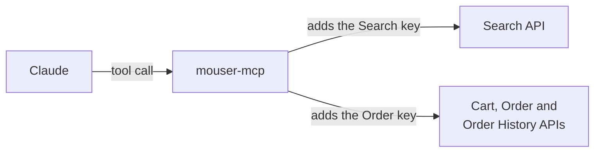

# Mouser MCP

[](https://github.com/RainnWorks/mouser-mcp/actions/workflows/build.yml)
[](https://www.npmjs.com/package/@rainnworks/mouser-mcp)
[](LICENSE)

An [MCP](https://modelcontextprotocol.io) server for the
[Mouser Electronics](https://www.mouser.com) APIs. It lets Claude, or any other
MCP client, search Mouser's parts, read your order history, fill your cart and
place orders.

It has one tool for each endpoint in Mouser's own published API specs, so it
covers all of the Search, Cart, Order and Order History APIs. It is not
affiliated with Mouser.

## Getting started

1. **Get your API keys.** Sign in to Mouser and open the
   [API Hub](https://www.mouser.com/api-hub/). Ask for a **Search API** key, and
   for the **Order API** key if you want carts, orders and order history.
   The Order, Cart and Order History APIs show **Pending** until Mouser
   approves them. Search works without them.

2. **Add the server to Claude Code:**

   ```sh
   claude mcp add mouser -s user \
     -e MOUSER_SEARCH_API_KEY=your-search-key \
     -e MOUSER_ORDER_API_KEY=your-order-key \
     -- npx -y @rainnworks/mouser-mcp
   ```

   For Claude Desktop, Cursor or any other client, add this to its MCP
   settings:

   ```json
   {
     "mcpServers": {
       "mouser": {
         "command": "npx",
         "args": ["-y", "@rainnworks/mouser-mcp"],
         "env": {
           "MOUSER_SEARCH_API_KEY": "your-search-key",
           "MOUSER_ORDER_API_KEY": "your-order-key"
         }
       }
     }
   }
   ```

   To run the latest code on `main` instead of the npm release, use
   `github:RainnWorks/mouser-mcp` in place of `@rainnworks/mouser-mcp`.

3. **Ask for a part.** For example: "Find an LM317 in a TO-92 package on Mouser
   and show me the stock and price breaks." Claude calls `post_search_keyword`
   and shows the results.

You need Node.js 20 or later. npx downloads the server the first time the
client starts it.

If you keep the keys in 1Password, read them when you add the server:

```sh
claude mcp add mouser -s user \
  -e MOUSER_SEARCH_API_KEY="$(op read 'op://Private/Mouser/Search API Key')" \
  -e MOUSER_ORDER_API_KEY="$(op read 'op://Private/Mouser/Order API Key')" \
  -- npx -y @rainnworks/mouser-mcp
```

## Use

| API | Key | Tools |
|---|---|---|
| Search | `MOUSER_SEARCH_API_KEY` | `post_search_keyword`, `post_search_partnumber`, `post_search_keywordandmanufacturer`, `post_search_partnumberandmanufacturer`, `get_search_manufacturerlist`, and the `v2_` versions of the last three |
| Order History | `MOUSER_ORDER_API_KEY` | `get_orderhistory_bydatefilter`, `get_orderhistory_bydaterange`, `get_orderhistory_salesordernumber`, `get_orderhistory_webordernumber` |
| Cart | `MOUSER_ORDER_API_KEY` | `get_cart`, `post_cart`, `post_cart_items_insert`, `post_cart_items_update`, `post_cart_item_remove`, `post_cart_insert_schedule`, `post_cart_update_schedule`, `post_cart_deleteall_schedule`, `post_order_item_createcartfromorder` |
| Order | `MOUSER_ORDER_API_KEY` | `get_order_countries`, `get_order_currencies`, `post_order_options_query`, `get_order_by_ordernumber`, `post_order`, `post_order_createfromorder` |

You need only the key for the APIs you use. A tool whose key is not set
returns an error that names the missing variable.

Some things to ask:

- "What did I order from Mouser this year?"
- "Is 595-LM317LILPR in stock, and what does 100 cost?"
- "Add 10 of each part in this BOM to my Mouser cart."

Each tool's description and input schema come from Mouser's spec, so the
client sees the same field names and notes as Mouser's own documentation.

**`post_order` places a real order, and the cart tools change your real
cart.** The server marks these tools as destructive and the search and read
tools as read-only. In Claude Code, allow the read-only tools and leave the
others to ask each time.

## How it works



Mouser publishes its API as two Swagger specs, and a copy of each is in
`spec/`. When the server starts, it turns each endpoint into a tool. The tool
takes the endpoint's path, query and body fields as its input. On a call, the
server adds the API key for that endpoint, sends the request to
`api.mouser.com`, and gives back the HTTP status and Mouser's reply as it is.

## Limits

- **Order, Cart and Order History need Mouser's approval.** Until then, those
  tools return `HTTP 401` with "Authorization has been denied for this request".
- **Replies are Mouser's raw JSON.** The server does not trim or reshape them,
  so a large search uses a lot of the model's context. Ask for fewer records
  with `records`.
- **Mouser limits how many calls each key can make.** A busy session can reach
  the limit, and Mouser then refuses calls until it resets.
- **The tools follow the copy of the specs in this repo.** If Mouser changes its
  API, the tools change only after `npm run update-specs` and a new release.

## Build from source

```sh
git clone https://github.com/RainnWorks/mouser-mcp
cd mouser-mcp
npm install
npm test
MOUSER_SEARCH_API_KEY=... node server.js
```

The server talks MCP over stdin and stdout, so it prints nothing when it
starts. Use the [MCP Inspector](https://github.com/modelcontextprotocol/inspector)
to try it by hand:

```sh
MOUSER_SEARCH_API_KEY=... npx @modelcontextprotocol/inspector node server.js
```

## Release

Set the new version, move the `[Unreleased]` notes in `CHANGELOG.md` under it,
commit, and merge. Then tag the merge commit:

```sh
git tag v$(jq -r .version package.json) && git push origin v$(jq -r .version package.json)
```

GitHub Actions then runs the tests, makes a GitHub release with the
CHANGELOG notes, and publishes `@rainnworks/mouser-mcp` to npm with trusted
publishing. [CONTRIBUTING.md](CONTRIBUTING.md) has the details.

## License

[Apache 2.0](LICENSE)
